# Public paid events, invoicing, and public/internal forms and quizzes: design

Status: **Draft for business and engineering review (2026-11-13).** Implemented so far: Phase 1 (Forms), Phase 2 (Yoco only, purpose-aware Payments) and the backend of Phase 3 (public ticketing, migration V45). Not yet built: ticket email, public and staff screens, and all of Phase 4. Diagrams use Mermaid
(rendered by GitHub and most Markdown viewers). Target code base: `backend-symfony` (the live API the frontend proxies
to) and `frontend`. Read `backend-symfony/AGENTS.md` first; every rule there applies to the work below.

Companion specs: `docs/online-payments.md` (current payments and public giving), `docs/visitor-self-check-in.md`
(the previous public, token-protected feature), `docs/forms.md` (the legacy Forms context in `backend/`, which was
never ported to `backend-symfony`).

---

## 1. Summary

The business asked for two things.

1. **Public paid events.** Anyone, without an account and without becoming a person record, can buy tickets (several
   types and prices per event, for example General and VIP), pays on Yoco, receives tickets and an invoice by email,
   and presents a QR code at the door.
2. **Public and internal forms.** Forms for general data collection and quizzes. A form is answered by the public
   (anonymously), by signed-in members, by signed-in staff, or by members of selected groups. Internal forms can
   either record who answered or be anonymous.

Both are built on patterns that already exist in `backend-symfony`: the public giving flow (guest orders, Turnstile,
honeypot, throttles, access token, encrypted email, confirmation email) and the visitor check-in link.

### 1.1 Decisions taken

| # | Decision | Source |
|---|---|---|
| D1 | Several ticket types and prices per event (General, VIP). | Business |
| D2 | No refund cut-off. Refunds are made in the Yoco dashboard and recorded by webhook; the app never moves money. | Business |
| D3 | Invoices are required. The church is **not VAT-registered**, so invoices carry no VAT and are not "tax invoices" until a VAT registration setting is switched on (VAT-ready design). | Business |
| D4 | The customer pays the provider's processing fee, shown as a separate line. | Business |
| D5 | **Yoco is the only payment provider for everything.** Payfast was never used (pilot), so it is removed. Monthly recurring giving is not required. | Business |
| D6 | Yoco plan is **Core**. Starting fee setting 2.95 % of the charge plus Yoco's VAT on its fee (effective about 3.39 %). The rate is a setting, not a constant. | Business, research |
| D7 | Forms: audiences `PUBLIC`, `MEMBERS`, `STAFF`, `GROUPS`. Internal forms choose per form between **identified** and **anonymous** responses. | Business |
| D8 | Quizzes exist for every audience. The leaderboard is a per-quiz option. | Business |
| D9 | Results are viewable as a list; no link to a person's profile. | Business |
| D10 | Response retention is **3 months**, then a hard delete of everything derived from the responses, including aggregates and leaderboards. | Business |
| D11 | Invoice header holds the church's legal name, address, registration number and NPO number. | Business |
| D12 | A full refund returns the processing fee; a partial refund returns ticket value only. If Yoco keeps its own fee on a refund, the church bears it. | Engineering recommendation, to be confirmed |
| D13 | When the church registers for VAT, VAT applies to the ticket price plus the processing fee, from the registration effective date, and never retroactively. | Engineering recommendation, accountant to confirm |

### 1.2 Assumptions to confirm (defaults chosen so work can start)

| # | Assumption |
|---|---|
| A1 | Free ticket types are allowed. An order with a zero total skips Yoco and is issued immediately. Paid totals must be at least R5.00 (existing payment-order rule). |
| A2 | Maximum 10 tickets per order (setting per occurrence). |
| A3 | One holder name per ticket is optional; it defaults to the buyer's name. Tickets are not transferable in v1. |
| A4 | No waitlist for public tickets in v1. |
| A5 | Seats are held for 15 minutes (same as the documented member flow). |
| A6 | Internal and anonymous forms allow one response per account. |

### 1.3 Non-goals (v1)

- Recurring billing, Payfast, or any provider other than Yoco.
- Seat maps or numbered seating.
- File upload questions in forms.
- Linking quiz results to a person's profile.
- Ticket transfers, discount codes, and bundle pricing.

---

## 2. Current state (what the design builds on)

| Area | Fact (verified in the repository) |
|---|---|
| Live backend | `backend-symfony` (Symfony 8.1, PHP 8.4, DBAL only, PostgreSQL, SQL migrations V1–V42). `docker-compose.yaml` proxies the frontend to it. `backend/` is the older Symfony app. |
| Public giving | `Payments\Presentation\PublicGivingController`, `StartGuestPaymentHandler`, `PaymentOrder::startGuest`, `GuestConfirmations`, migration V42. Guest orders have `donor_id` NULL, an encrypted email, a hash used for throttling and an access-token hash. |
| Provider calls | `ResumeCheckout` and `ProcessNotification` are provider-boundary handlers: no provider call inside a transaction; `PaymentPosting` runs in its own transaction after verification. |
| Payments schema | `payments_orders` requires `fund_id`, `amount_minor BETWEEN 500 AND 100000000`, has `recurring` and subscription columns, and the guard trigger `payments_guard_order` freezes the original intent. `payments_charges`, `payments_refunds`, `payments_reviews` (with `fee_minor`), `payments_notifications`, `payments_history` exist. |
| Vault | `SubscriptionVault` (AES-GCM) also encrypts the guest email. It must survive the Payfast removal. |
| Events | `event_registrations` requires `person_id`. `RegistrationPolicy` has capacity and waitlist but **no price**. Lock order is documented in `docs/porting/events.md`. |
| Ticket pricing | `docs/online-payments.md` describes member ticket purchases, but no ticket or price code exists in `backend-symfony/src/Events` or its migrations. |
| Security config | `security.yaml` `access_control` is first-match; public routes are explicit allowlist entries. |
| Rate limiters | Declared in `config/packages/framework.yaml`, with `when@test` overrides at 100000. |
| Forms | Exist only in the legacy `backend/src/Forms`: 5 field types, 1–20 fields, public token link, HMAC challenge plus honeypot, review-then-link-person flow. Frontend `PublicFormView.vue` already calls `GET/POST /api/public/forms/{token}`, which `backend-symfony` does not serve. |
| Email | `Communications\Application\Contract\EmailDeliveries` plus tagged `DeliveryEligibility` and `TemplatePublicationPolicy`. I did not verify that it supports attachments (see section 9.5). |
| Purge precedent | `ChildrenMinistry` has `PurgeExpiredIncidents`. |

### 2.1 Why public giving cannot simply be reused for tickets

1. Payments always posts to the Giving ledger, and ticket revenue must not appear in donor statements or giving
   reports.
2. `payments_orders.fund_id` is mandatory and the order model has no notion of what is being bought.
3. Registrations and attendance are keyed by person, and a public buyer must not become a person.
4. Capacity has to count unpaid holds, because a buyer spends minutes on Yoco's page.

---

## 3. Architecture

### 3.1 Contexts and dependencies

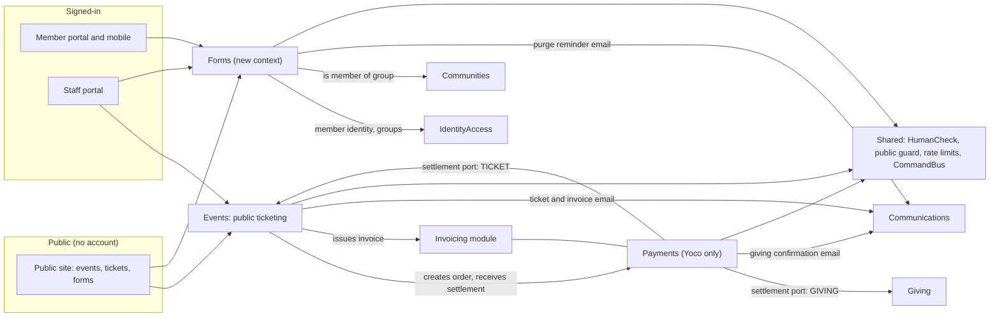

Rules that follow from `AGENTS.md` and `ContextBoundaryTest`:

- Contexts talk only through published `Application\Contract` interfaces. Payments defines the settlement port;
  Events implements it. Forms reads group membership through a contract that Communities publishes.
- `HumanCheck` (Turnstile) currently lives in Payments. A second context now needs it, so it moves to `Shared`.
- Forms is a **flat** context (`src/Forms/{Domain,Application,Infrastructure,Presentation}`), like Giving and
  Payments. Invoicing lives inside Payments (it is a financial record of a payment order), exposed to Events through a
  contract.

### 3.2 Shared public-endpoint kit

Four public surfaces will exist (visit link, giving, ticketing, forms). Extract what they repeat into `Shared`:

| Piece | Where it is today | Target |
|---|---|---|
| Turnstile `HumanCheck` | `Payments\Application\Contract\HumanCheck` | `Shared\Application\HumanCheck` |
| `no-store` JSON response helper | private method in `PublicGivingController` | `Shared\Presentation\NoStoreJson` |
| Honeypot convention | repeated in controllers | `Shared\Presentation\Honeypot` |
| Client plus subject throttle | repeated per controller | `Shared\Presentation\PublicThrottle` (takes two limiter factories) |

Behaviour is unchanged. Production keeps refusing public checkouts and submissions when `TURNSTILE_SECRET_KEY` is not
set; other environments skip the check.

---

## 4. Payments changes (Yoco only, purpose-aware)

### 4.1 Remove Payfast

Payfast was never used, so it is removed rather than disabled.

| Remove | Keep (renamed where noted) |
|---|---|
| Payfast hosted gateway and signing, ITN controller path, network and signature checks | Yoco gateway, Yoco HMAC webhook verification, Yoco webhook administration |
| Subscriptions: `ManageSubscription`, subscription status handling, recurring order fields in use | The AES-GCM vault (rename `SubscriptionVault` to `PayloadVault`; it still encrypts guest emails and provider credentials) |
| Payfast settings screens and `PAYFAST_*` env | Provider-boundary handlers, `PaymentPosting`, refunds, reviews, reconciliation |
| Java-captured Payfast vectors and tests | `PaymentHash` and the Java vectors that still apply |

Database (expand and contract, never edit an applied migration):

1. Pre-flight query must return zero: `SELECT count(*) FROM payments_orders WHERE provider <> 'yoco' OR recurring`.
   If it is not zero, stop and review the pilot data.
2. Replace the provider CHECK with `provider = 'yoco'`.
3. Leave the `recurring` and subscription columns in place and unused for now; a later migration drops them once the
   code no longer reads them.

### 4.2 Make orders purpose-aware

New columns on `payments_orders`:

| Column | Meaning |
|---|---|
| `purpose` | `GIVING` or `TICKET`. Default `GIVING` so existing rows are valid. |
| `purpose_ref` | UUID of the thing being paid for (the ticket order). NULL for giving. |
| `fund_id` | Becomes nullable. `CHECK (purpose <> 'GIVING' OR fund_id IS NOT NULL)`. |

The `payments_guard_order` trigger's immutable tuple is extended with `purpose` and `purpose_ref`, so the original
intent still cannot change. The guest-shape CHECK from V42 is extended so a `TICKET` order is also a guest order (no
donor, encrypted email, access hash).

### 4.3 Settlement port

`PaymentPosting::postCharges` currently calls `OnlineGivingLedger::post` directly. It will instead resolve a tagged
`PurposeSettlement` by `order.purpose`.

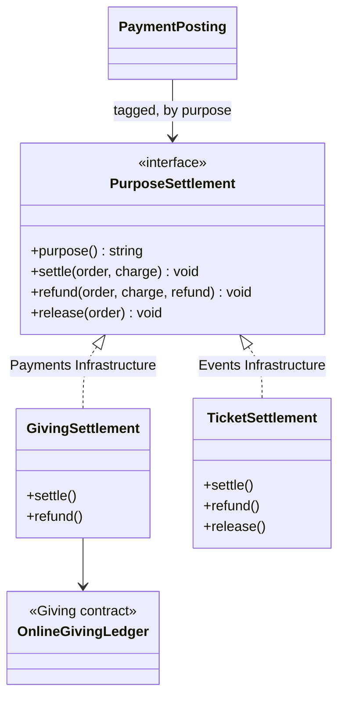

- `settle` runs inside `PaymentPosting`'s own transaction, after the payment order row is locked.
- `release` is called for sandbox (test mode) charges, which never settle money: Events releases the hold and issues
  nothing, exactly like the documented member flow.
- `GuestConfirmations` stays for `GIVING` only. Ticket emails come from Events (section 5.7).

---

## 5. Public paid events

### 5.1 Data model

New tables (next migrations start at V43).

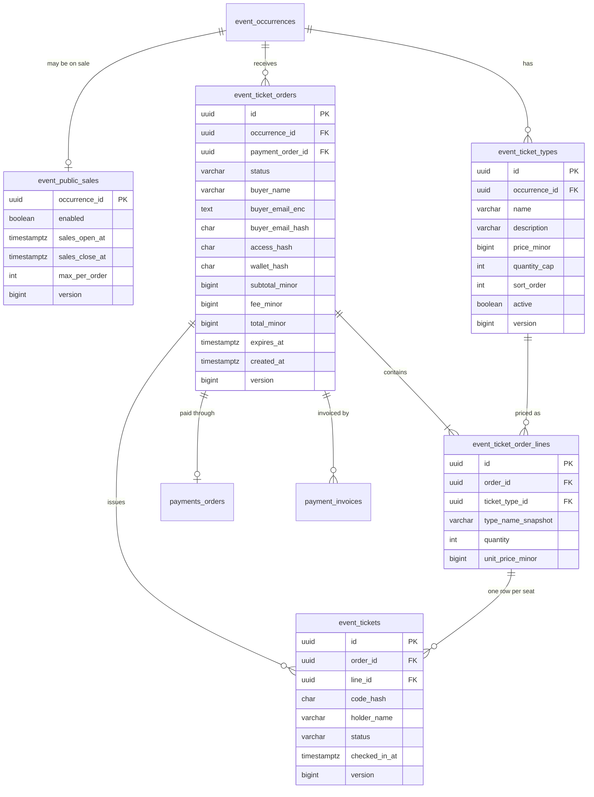

Notes:

- `price_minor` is an integer in cents. Never a float.
- A type's price cannot change while a live hold references it (same rule as the member flow). Existing lines keep
  `unit_price_minor` and `type_name_snapshot`, so later edits never alter history.
- `event_tickets.code_hash` stores a hash of the QR secret, never the secret. The QR payload is
  `ticketId.secret`; the scanner sends it in a POST body.
- Buyer email is stored encrypted with the payments vault and hashed with a keyed HMAC for throttling, like public
  giving. The access token and the wallet token are stored only as hashes.
- Ticket orders never reference a person. There is deliberately no `person_id` anywhere in these tables.

### 5.2 Capacity

Seats in use = confirmed person registrations + issued tickets + live holds (`RESERVED`, `expires_at > now`).
Each ticket type also has its own cap. A purchase must fit both. The count and the insert happen under the
occurrence row lock so two buyers cannot take the last seat.

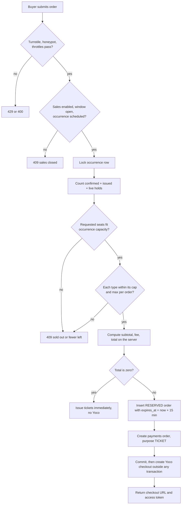

### 5.3 Pricing and the processing fee

The client never sends an amount; it sends ticket types and quantities. The server prices them.

Settings (stored, editable by staff with `payments.manage`, versioned): `fee_rate_ppm`, `fee_fixed_minor`,
`fee_rate_includes_provider_vat`, `provider_vat_ppm`.

All arithmetic is integer:

```
effective_rate_ppm = fee_rate_ppm * (1 + provider_vat)          // 29500 ppm * 1.15 = 33925 ppm
total_minor        = ceil((subtotal_minor + fee_fixed_minor) * 1_000_000 / (1_000_000 - effective_rate_ppm))
fee_minor          = total_minor - subtotal_minor
```

Worked example: a R200.00 ticket (20 000 cents), 2.95 % plus Yoco's VAT, no fixed fee:
`ceil(20000 * 1e6 / 966075) = 20703`, so the fee is 703 cents and the customer pays R207.03.

The real fee that Yoco takes is recorded in the existing settlement review (`payments_reviews.fee_minor`), so staff
can see how close the estimate is. International cards cost more on the Core plan; the single estimated rate is
accepted as a known approximation. The price, fee and total are shown as separate lines on checkout, in the email and
on the invoice (consumer-protection: the total is visible before payment).

### 5.4 Purchase sequence

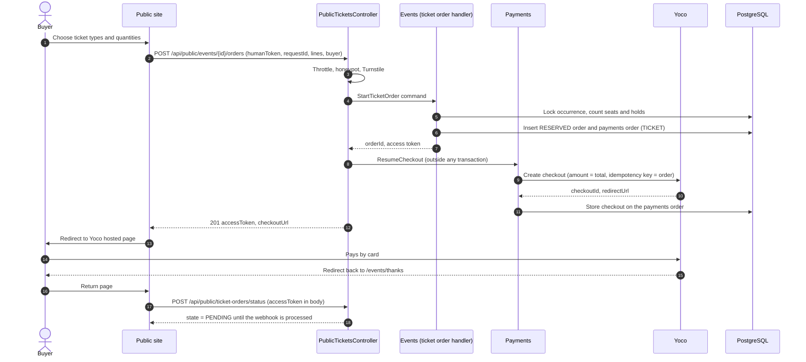

### 5.5 Settlement sequence (webhook to tickets)

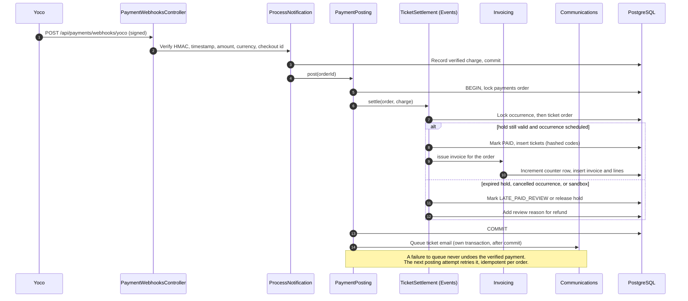

Lock order for every ticket write path (reservation, settlement, refund, expiry sweeper, scan):
**payments order → occurrence → ticket order → tickets**. This is the order `PaymentPosting` already imposes (order row
first). Add this to `docs/porting/events.md` and a recording-fake test per multi-lock handler, as `AGENTS.md`
requires.

### 5.6 Order and ticket states

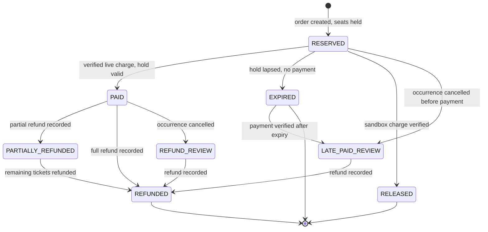

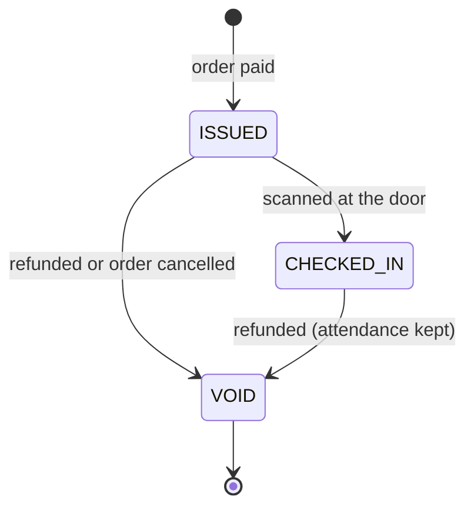

A late payment is retained and flagged for refund review and never confirms a place, which matches the existing
documented behaviour. A ticket refunded after check-in is marked void but the attendance record stays, so reports
remain true.

### 5.7 Delivery to the buyer

| Item | Rule |
|---|---|
| Status page | `POST /api/public/ticket-orders/status` with the access token in the body (never in a URL), like public giving. |
| Ticket email | Queued after commit through `EmailDeliveries`. Contains one QR per ticket and the invoice reference. Revalidated before each send: the order must still be PAID and not refunded, and the address and content must match what was queued (same pattern as `PaymentDeliveryEligibility`). |
| Wallet link | The email's "view your tickets" link carries a long-lived wallet token in the URL **fragment** (`#`), so it never reaches server logs or `Referer`. The page reads the fragment and POSTs it in the body. The ticket QR codes are shown there. |
| Resend | Staff can resend; a buyer can request a resend by email, throttled, and always answered with the same message whether or not the address exists. |

### 5.8 Refunds

Refunds are completed in the Yoco dashboard; Yoco's authenticated refund webhook is recorded automatically
(`docs/online-payments.md`). The new rules sit in `TicketSettlement::refund`.

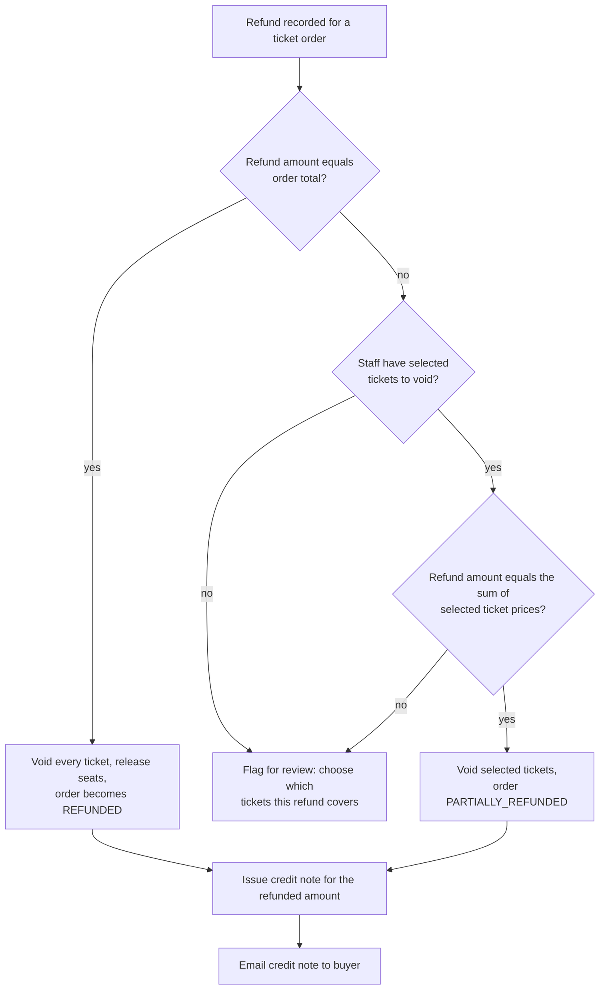

- A full refund returns ticket value plus processing fee (D12). A partial refund returns ticket value only.
- Staff select tickets with `POST /api/events/occurrences/{id}/ticket-orders/{orderId}/voids`. Without a selection, an
  unmatched partial refund stays in review. Nothing is guessed.
- Cancelling a ticket in the app never moves money. Review cannot close while a refund is outstanding.
- There is no cut-off; a refund after the event is allowed. It voids the ticket and keeps attendance.

### 5.9 Door scanning

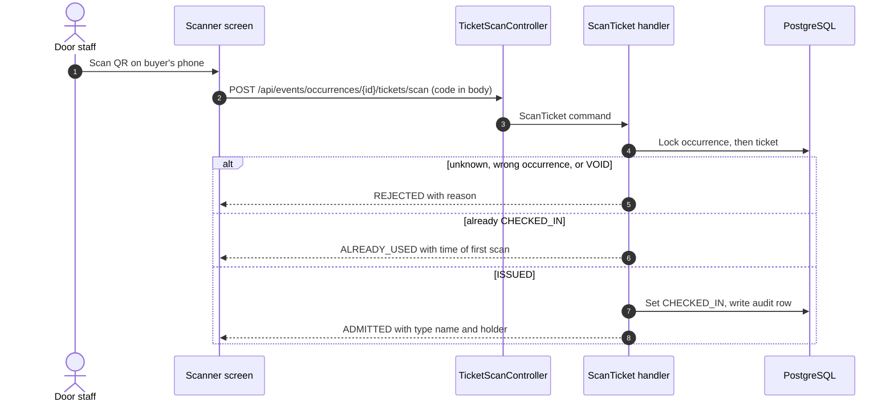

Attendance and the closeout counts must include tickets. Because registrations and attendance are person-keyed,
ticket check-ins live in their own table and the roster and closeout **read models** union the two. (I did not read
the attendance tables, migration V16, in this analysis; confirm their shape before writing the union.)

### 5.10 API

Public (add to `security.yaml` explicitly, before the `^/api/` catch-all):

| Method and path | Purpose |
|---|---|
| `GET /api/public/events` | Events on sale: title, date, venue, lowest price, availability flag. |
| `GET /api/public/events/{occurrenceId}` | Detail, ticket types with prices, seats left bucket (not exact numbers), fee settings for display. |
| `POST /api/public/events/{occurrenceId}/orders` | Start an order. Body: `requestId`, `lines[]`, `buyer{name,email}`, optional `billing{name,address,vatNumber}`, `humanToken`, `website`. |
| `POST /api/public/ticket-orders/status` | Outcome by access token (body). |
| `POST /api/public/ticket-orders/wallet` | Tickets and invoices by wallet token (body). |
| `POST /api/public/ticket-orders/resend` | Request a resend, throttled. |

Staff (authenticated, `#[IsGranted]` plus handler checks through `PermissionChecker`, `expectedVersion` required):

| Method and path | Permission |
|---|---|
| `PUT /api/events/occurrences/{id}/public-sales` | `events.tickets.manage` |
| `GET/POST/PUT /api/events/occurrences/{id}/ticket-types` | `events.tickets.manage` |
| `GET /api/events/occurrences/{id}/ticket-orders` and `/{orderId}` | `events.tickets.read` (buyer contact needs `events.tickets.contacts`) |
| `POST .../ticket-orders/{orderId}/voids`, `.../resend` | `events.tickets.manage` |
| `POST /api/events/occurrences/{id}/tickets/scan` | `events.tickets.scan` |

### 5.11 Expiry and occurrence changes

A scheduled job (added to `Schedule.php`, alongside the existing maintenance worker) marks lapsed `RESERVED` orders
`EXPIRED`. A cancelled occurrence moves every `PAID` order to `REFUND_REVIEW` and blocks new sales. The Yoco checkout
lifetime must be at least as long as the hold; confirm Yoco's checkout expiry and align the two.

---

## 6. Invoicing (VAT-ready)

### 6.1 Principles

- Every paid ticket order gets an invoice; every recorded refund gets a credit note.
- The church is not VAT-registered, so today documents are titled **Invoice** with **no VAT lines**.
- Registration is a setting with an effective date. Documents issued before that date never change. Documents issued
  from that date are titled **Tax Invoice**, carry the VAT number, and show VAT.
- Giving is not invoiced. Donations are not ticket supplies.
- Documents are insert-only (trigger, like `giving_reject_mutation`) and are rendered from a stored snapshot, never
  recomputed.

### 6.2 Data model

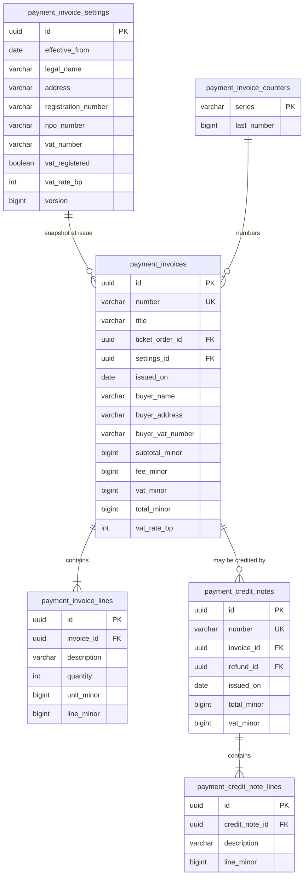

### 6.3 Numbering

Postgres sequences leave gaps after a rollback, which an invoice series must not have. Numbers come from a counter
row (`payment_invoice_counters`, series `INV` and `CN`) that is incremented with `UPDATE ... RETURNING` **in the same
transaction** that inserts the document. A rolled-back transaction rolls the counter back too. The cost is that
issuing is serialised per series, which is acceptable at church ticketing volumes. Format example `INV-2026-000123`.

### 6.4 Issuing flow

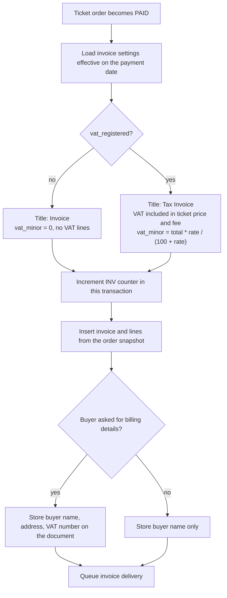

Document contents. Always: title, number, issue date, church legal name, address, registration number, NPO number,
buyer name, line description (event, ticket type, date), quantity, unit price, processing fee line, total. When VAT
registered, additionally: VAT number, the VAT rate, the VAT amount and the words "Tax Invoice". Which extra buyer
details are mandatory above a value threshold is a tax rule to confirm with the church's accountant before
registration; the document model already stores optional buyer address and VAT number.

### 6.5 Delivery

I did not verify whether `Communications` supports attachments (`DeliverySnapshot` carries a content type, but I saw no
attachment concept). Two acceptable options, decided during Phase 4:

1. Attach a PDF (needs a PDF library and an attachment extension to `EmailDeliveries`).
2. Show the invoice on the wallet page and include a link; the page can be printed to PDF.

The rendered document is generated deterministically from the stored snapshot either way.

---

## 7. Forms and quizzes

### 7.1 Model at a glance

Two independent settings plus a set of options.

| Setting | Values |
|---|---|
| `kind` | `DATA_COLLECTION` or `QUIZ` |
| `audience` | `PUBLIC`, `MEMBERS`, `STAFF`, `GROUPS` |
| `identity_mode` | `ANONYMOUS` or `IDENTIFIED` (`PUBLIC` is always `ANONYMOUS`) |
| quiz options | scoring, show score after submit, show correct answers after submit, `leaderboard` on or off, leaderboard size |
| limits | `opens_at`, `closes_at`, `max_responses`, `retention_months` (1 to 3, default 3) |

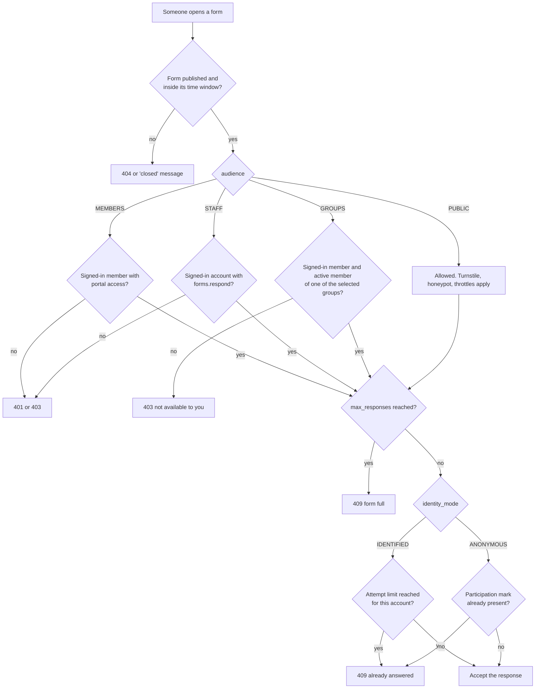

Responses also carry `form_version`, so a response is always judged against the exact definition it was answered on.

### 7.2 Data model

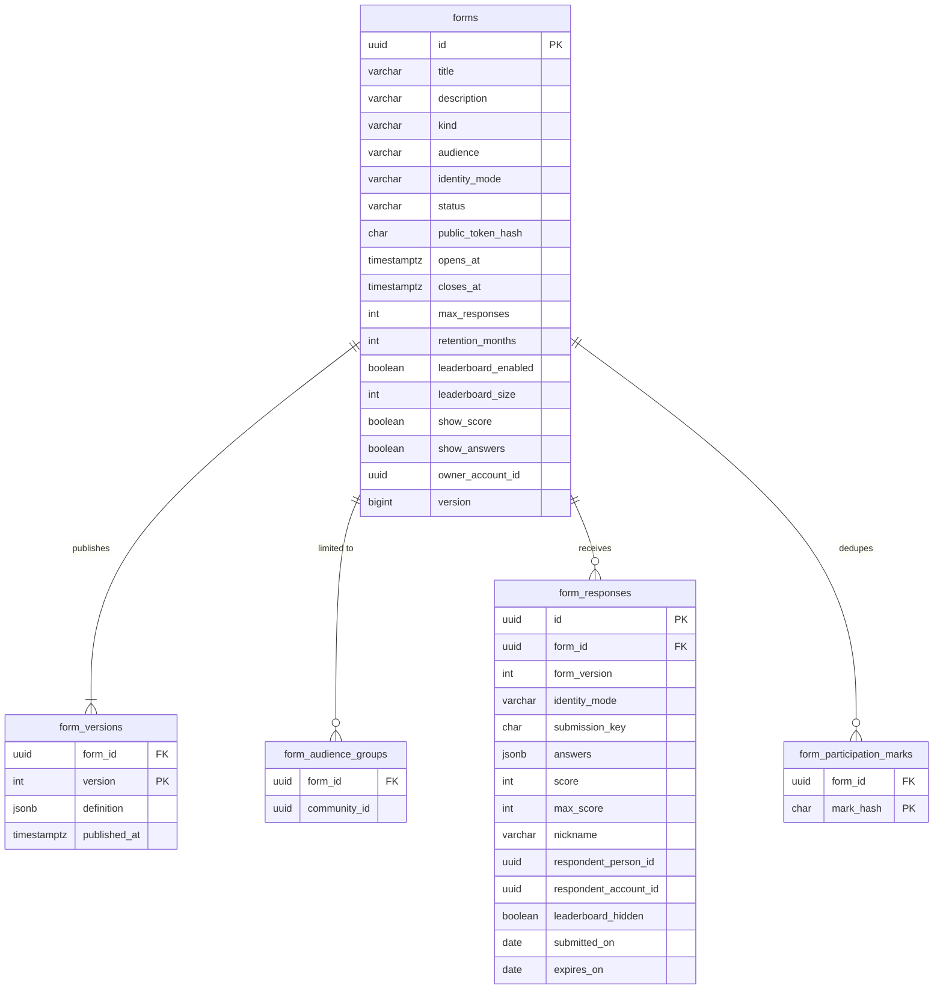

Key constraints (the privacy guarantees are enforced by the database, not by convention):

- `forms`: `CHECK (audience <> 'PUBLIC' OR identity_mode = 'ANONYMOUS')`, and `UNIQUE (id, identity_mode)`.
- `forms`: `identity_mode` and `audience` cannot change once the first response exists (a trigger).
- `form_responses` has a composite foreign key `(form_id, identity_mode)` to `forms (id, identity_mode)`, plus
  `CHECK (identity_mode = 'IDENTIFIED' OR (respondent_person_id IS NULL AND respondent_account_id IS NULL))`.
  An anonymous form therefore **cannot** physically hold a respondent id.
- `UNIQUE (form_id, submission_key)` makes a retried submit idempotent.
- `expires_on = submitted_on + retention_months`, with `retention_months BETWEEN 1 AND 3`.
- For `ANONYMOUS` forms only a date is stored (`submitted_on`), not a timestamp, which makes re-identification by
  timing harder.
- `form_participation_marks` stores `HMAC(secret, form_id | account_id)` for signed-in anonymous forms. It has no
  `response_id` and no timestamp, so a mark cannot be linked to a response. Anonymous signed-in forms allow one
  response per account (A6).
- Definition JSON holds questions. Supported types: text, long text, email, number, rating, date, single choice,
  multiple choice, checkbox. Limits: at most 50 questions, 20 options each, bounded lengths. A quiz question also
  stores `correct` and `points` inside the definition.

### 7.3 Public projection (quiz answers never leak)

The public and internal "fetch form" endpoints return a **separate projection** built from the definition: questions,
options, labels, required flags, but never `correct` or `points`. A unit test asserts that the serialised public
projection contains neither key anywhere. Scoring happens only on the server at submit time.

### 7.4 Public submission sequence

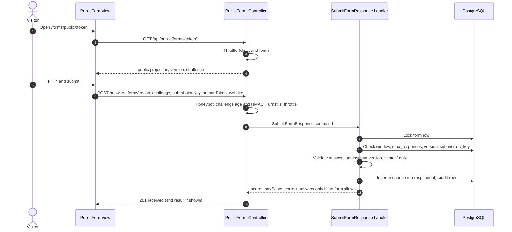

The existing `PublicFormView.vue` contract is preserved (`answers`, `formVersion`, `challenge`, `submissionKey`,
`website`); `humanToken` is added.

### 7.5 Internal submission sequence

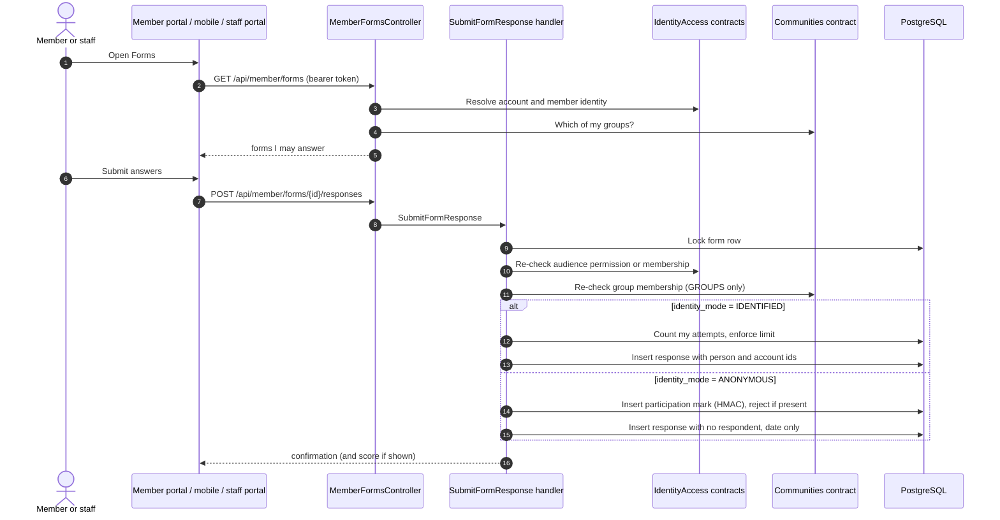

Authorisation is rechecked inside the handler under the form lock; `#[IsGranted]` is only the second line of defence,
per `AGENTS.md`.

### 7.6 Quiz scoring and leaderboard

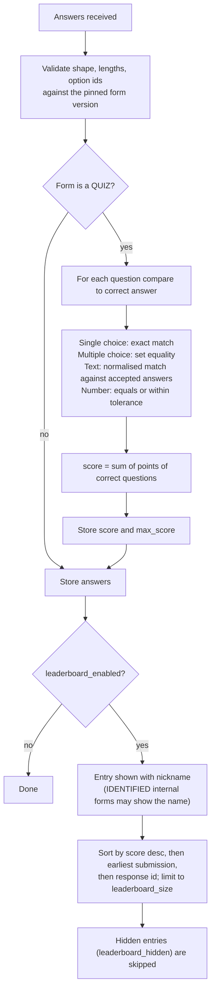

- The leaderboard is a query over `form_responses`; nothing is cached, so the purge removes it automatically.
- A nickname is free text with length limits and HTML-safe output. Staff can hide an entry
  (`forms.responses.moderate`).
- Public forms can only show nicknames. Names are shown only on `IDENTIFIED` internal quizzes.

### 7.7 Results and privacy for anonymous internal forms

- Per-question summaries (counts per option, rating averages, quiz score distribution) are computed on demand.
- For `ANONYMOUS` forms, summaries are hidden until at least 5 responses exist (setting), and the individual
  response table shows no respondent and no time of day. This prevents unmasking in a small group.
- For `IDENTIFIED` forms, reading individual responses goes through an audited use case (an audit row is written in
  the same transaction), like other restricted data in the codebase.
- CSV export neutralises cells that begin with `=`, `+`, `-`, `@` or a tab (formula injection) and streams large sets.
- The staff screen shows each form's purge date and warns before it.

### 7.8 Retention and purge

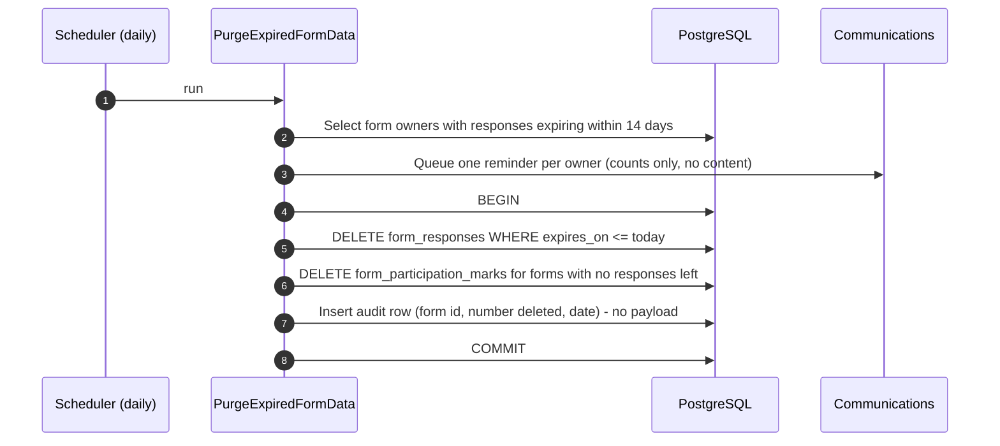

- Deletion is a hard delete. Aggregates and leaderboards derive from the rows and disappear with them (D10).
- An `ANONYMOUS` form's marks are removed when its last response expires, so a form can be reopened cleanly.
- Backups contain deleted data until they rotate. Set backup retention to be no longer than the retention promised in
  the privacy notice.
- This rule applies to forms only. Invoices and credit notes are tax records and are retained as the law requires;
  say so in the privacy notice.

### 7.9 API

Public (allowlisted in `security.yaml`):

| Method and path | Purpose |
|---|---|
| `GET /api/public/forms/{token}` | Public projection (kept compatible with `PublicFormView.vue`). |
| `POST /api/public/forms/{token}` | Submit a response. |
| `GET /api/public/forms/{token}/leaderboard` | Only when enabled; nicknames only. |

Signed-in (members, staff, group members):

| Method and path | Purpose |
|---|---|
| `GET /api/member/forms` | Forms I may answer (`MEMBERS`, `GROUPS`, and `STAFF` if I hold `forms.respond`). |
| `GET /api/member/forms/{id}` | Projection. |
| `POST /api/member/forms/{id}/responses` | Submit. |
| `GET /api/member/forms/{id}/leaderboard` | When enabled. |

Staff management (`expectedVersion` required on every body):

| Method and path | Permission |
|---|---|
| `GET/POST/PUT /api/forms`, `POST /api/forms/{id}/publish`, `.../close` | `forms.read` / `forms.manage` |
| `GET /api/forms/{id}/responses`, `/summary`, `/export` | `forms.responses.read` |
| `POST /api/forms/{id}/responses/{rid}/hide` | `forms.responses.moderate` |

### 7.10 Group restriction contract

Forms may not read Communities' tables. Communities must publish a small contract, for example
`CommunityMembershipReader::activeCommunityIds(personId): list<string>`. I have not verified that Communities already
exposes this; check it first and add it if missing. Forms stores selected community ids and calls the contract on
fetch and on submit.

### 7.11 Form lifecycle

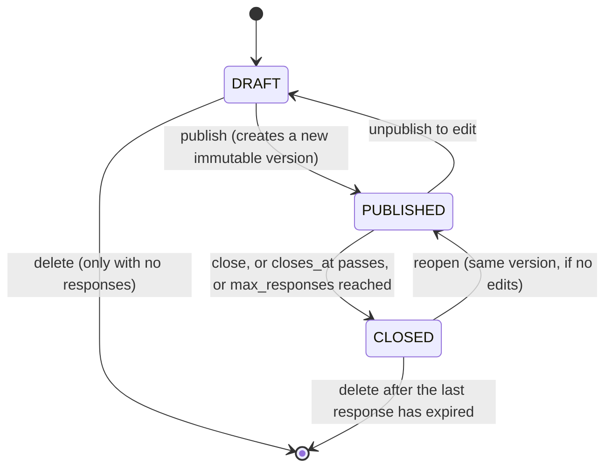

---

## 8. Cross-cutting

### 8.1 Security and abuse

| Threat | Control |
|---|---|
| Bots flooding public forms or checkouts | Turnstile, honeypot, per-client and per-subject throttles, response and order caps. |
| Card testing through the ticket checkout | Turnstile, per-email and per-client limits, plus a per-occurrence limit. |
| Seat-denial by bots holding inventory | Short hold (15 min), max tickets per order, cap on live holds per client and email. |
| Price tampering | The server prices every order from stored ticket types; the client never sends an amount. |
| Replay and double-submit | Idempotent `requestId` and `submissionKey` with request hashes (409 on a changed body). |
| Token leakage | Access, wallet and public-form tokens stored as hashes. Never placed in query strings; the wallet link uses the URL fragment. |
| Spoofed payment callbacks | Existing Yoco HMAC, timestamp, environment, amount and currency verification. Unverified requests never post. |
| Quiz cheating | Correct answers are never in any public or member projection and are tested for that. |
| Unmasking anonymous respondents | DB constraints, no respondent columns on anonymous rows, date-only timestamps, no mark-to-response link, minimum-responses threshold. |
| CSV injection | Cell neutralisation on export. |
| Over-collection of personal data | Only the fields a form asks for; no IP stored (throttling uses a keyed hash only). |

### 8.2 POPIA

- Ticket buyers: collect name and email (and optional billing details). Say what is collected, why, and that invoices
  are kept for the statutory period.
- Forms: show the retention period and, for anonymous internal forms, a clear "your answers are not linked to you"
  notice before the form starts. Add a consent line to public forms that collect contact details.
- Retention: forms 3 months (hard delete). Invoices and credit notes follow tax-record rules. Ticket orders keep the
  buyer's contact only as long as the invoice and refund window require; set an explicit period when the policy is
  agreed.

### 8.3 Permissions (new)

| Code | Meaning |
|---|---|
| `events.tickets.read` | See ticket orders and counts. |
| `events.tickets.contacts` | See buyer contact details. |
| `events.tickets.manage` | Configure sales and ticket types, void tickets, resend. |
| `events.tickets.scan` | Scan at the door. |
| `payments.invoices.manage` | Edit invoice settings, VAT registration. |
| `forms.read`, `forms.manage` | Definitions and publishing. |
| `forms.responses.read` | Read and export responses (audited for identified forms). |
| `forms.responses.moderate` | Hide leaderboard entries. |
| `forms.respond` | Answer `STAFF` forms. |

Migrations grant them to the existing `administrator` role, as earlier migrations do. Permission IDs follow the
existing pattern in `migrations/`; assign the next free ids when writing the migration.

### 8.4 Frontend and mobile

| Surface | Work |
|---|---|
| Public site | `/events` list, `/events/:id` ticket picker, checkout redirect, thanks page, `/tickets` wallet page (reads the URL fragment), invoice view. Adapt `PublicGiveView.vue` and its Yoco return handling. |
| Public forms | Extend `PublicFormView.vue` (new question types, Turnstile token, quiz result, leaderboard). |
| Staff portal | Ticket types and sales panel on `OccurrenceView`; orders list with void and resend; door scanner; invoice settings; forms builder, results, export, moderation. |
| Member portal and mobile | "Forms" list, form-taking screen, quiz result and leaderboard. |
| Build and CSP | `VITE_TURNSTILE_SITE_KEY` already exists; the Nginx CSP already allows `challenges.cloudflare.com`. |

### 8.5 Configuration

New or changed settings: `TURNSTILE_SECRET_KEY` (already required in production), ticket fee settings and invoice
settings (database, not env), rate limiter definitions in `framework.yaml` with `when@test` overrides, the Yoco
credentials and webhook that already exist. Remove the `PAYFAST_*` variables.

### 8.6 Testing

Follow `AGENTS.md`: handlers in isolation with in-memory fakes (permission first, stale version rejected, audit only on
success); API tests for 401, 403, 409 and 400; rollback of failed commands.

| Test | Proves |
|---|---|
| Oversell with `ParallelSession` | Two buyers racing for the last seat: one succeeds, one gets 409; the second waits on the occurrence lock. |
| Lock-order recording fakes | Order of locks in reservation, settlement, refund, sweeper and scan. |
| Settlement idempotency | A duplicate webhook issues tickets and an invoice once. |
| Provider calls outside transactions | Same assertion used for giving. |
| Late payment and cancelled occurrence | Order lands in review, no ticket issued. |
| Fee arithmetic | Boundary cases and the R200 worked example (20 703 cents). |
| Invoice numbering | No gaps after a forced rollback; non-registered documents have zero VAT; a registration effective date changes only later documents. |
| Public projection | Contains no `correct` or `points`. |
| Anonymous form | Inserting a respondent id is rejected by the database. |
| Participation mark | Cannot be joined to a response. |
| Purge | Deletes responses, marks and leaderboard; keeps nothing derived; writes an audit row without payload. |
| Payfast removal | Existing giving flows still pass after the refactor. |
| Architecture tests | `ContextBoundaryTest` and deptrac stay green. |

Run `make check` (cs, stan level 8, deptrac, tests) in `backend-symfony` before finishing each change.

---

## 9. Delivery plan

### 9.1 Phases

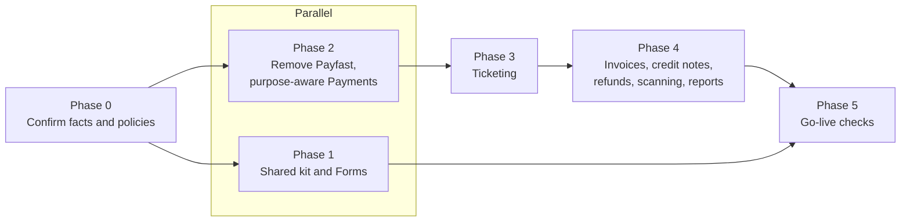

| Phase | Scope | Migration |
|---|---|---|
| 0 | Confirm the Yoco Core rate and refund behaviour; confirm no pilot Payfast rows; check Communities membership contract; check email attachments; confirm assumptions A1 to A6. | none |
| 1 | Shared public kit. `Forms` context: definitions, versions, audiences, identity modes, public and internal submit, quiz scoring, leaderboard, results, export, purge, frontend and mobile screens. | V43 forms |
| 2 | Remove Payfast. `purpose` and `purpose_ref`, nullable `fund_id`, settlement port, Giving adapter, Yoco-only constraint. Giving tests stay green. | V44 payments purpose |
| 3 | Public sales, ticket types, capacity, reservation, fee, Yoco checkout, settlement, ticket email, wallet page, sweeper, public pages. | V45 ticketing |
| 4 | Invoicing and credit notes, refund voids, door scanning, roster and closeout union, reports. Must land before real sales. | V46 invoicing |
| 5 | Security review of the new public surfaces and Payments diff, load check of the invoice counter, Yoco sandbox end-to-end, backup retention, privacy notices. | none |

### 9.2 Risks

| Risk | Mitigation |
|---|---|
| Fee estimate differs from Yoco's real fee (international cards, plan change). | Fee is a setting; settlement review shows the real fee; revisit after the first events. |
| VAT registration becomes compulsory sooner than expected. | VAT-ready documents from day one. Ask the accountant now. |
| Invoice counter serialises issuing. | Acceptable at this volume; measure in Phase 5. |
| Attendance tables are person-keyed. | Separate ticket check-in table with a union read model; confirm shape from V16 first. |
| Email attachments unsupported. | Fall back to the wallet page invoice view. |
| Anonymous forms in tiny groups can be unmasked by content. | Minimum-responses threshold, date-only timestamps, warning in the builder. |
| Hold shorter than Yoco checkout lifetime causes late-paid orders. | Align the two; late payments are flagged for refund, never lost. |
| Backups outlive the 3-month promise. | Shorten backup retention or state it in the privacy notice. |

### 9.3 Open items (facts to look up, not design decisions)

1. Yoco Core exact local and international card rates, and whether Yoco returns its fee on refunds.
2. Whether the church must register for VAT now, and whether donations count towards the threshold.
3. Accountant's confirmation of D13 (VAT on the processing fee after registration).
4. Mandatory buyer details on invoices above any statutory value threshold.
5. Final retention period for ticket-order contact data.
6. Assumptions A1 to A6.

### 9.4 Documentation to update when building

`docs/online-payments.md` (Yoco only, tickets), `docs/forms.md` (new context and the legacy note),
`backend-symfony/docs/porting/events.md` (ticket lock order), `backend-symfony/docs/porting/payments.md` (Payfast
removal, settlement port), `backend-symfony/AGENTS.md` (Forms, ticketing and invoicing bullets, like the existing
Giving and Payments bullets), `docs/production-runbook.md` (purge job, backup retention).

### 9.5 Facts not verified while writing this document

The `backend-java` specification referenced by `AGENTS.md` is not in the repository. I did not read the attendance
tables (V16), the Communications attachment support, the Communities contracts, or the full `ProcessNotification`
handler. Each is listed as a Phase 0 check above.
